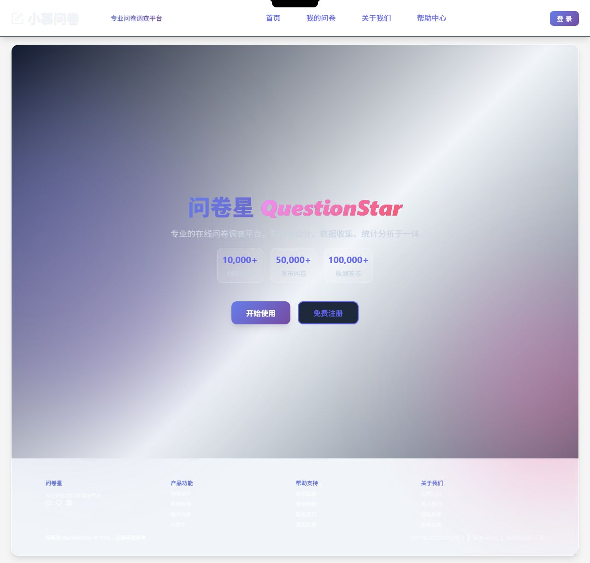
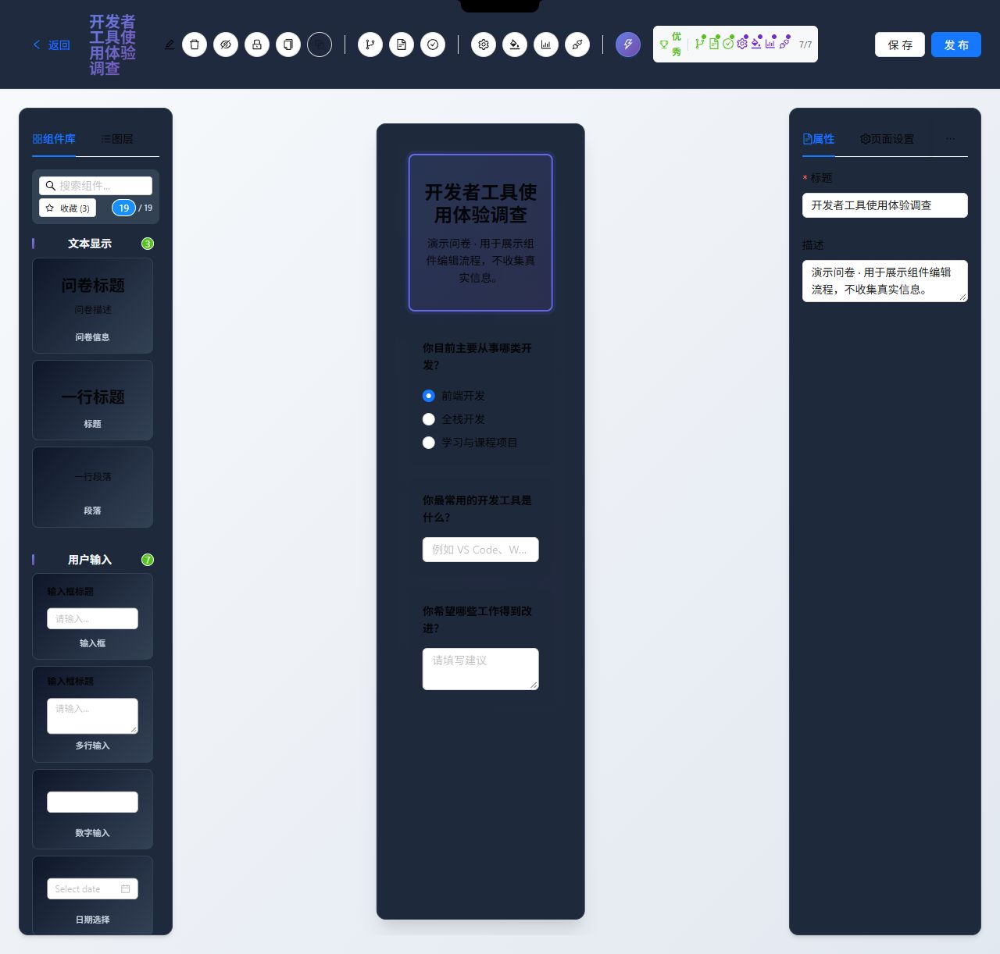
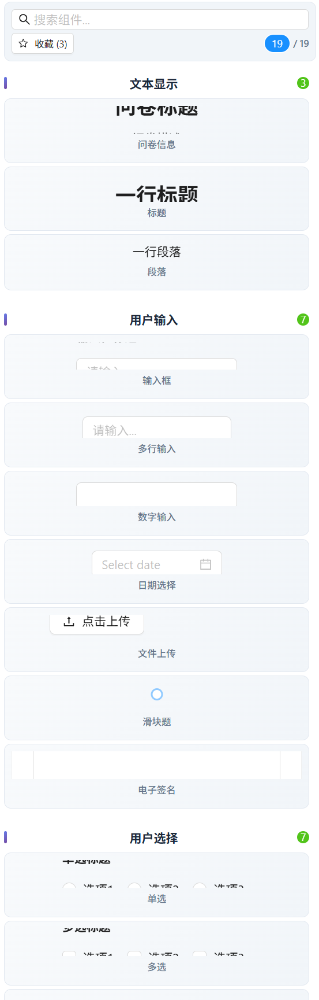
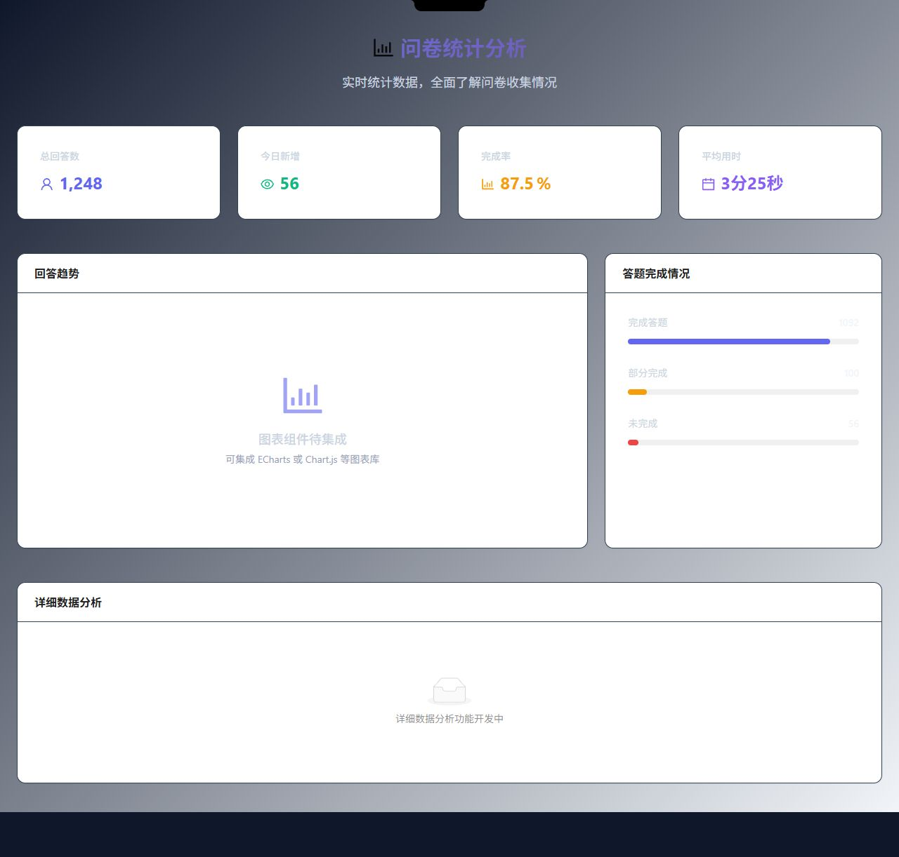

**简体中文** | [English](./readme-en.md)

<p align="center">
  
</p>

<div align="center">

# 问卷星 · B 端

<p><strong>从组件编排到问卷管理与统计的可视化工作台</strong></p>

<p>
  <a href="https://github.com/tuolola/questionnaire-star---react"></a>
  <a href="https://gitee.com/guolola/questionnaire-star---react"></a>
</p>

<p>
  
  
  
  
</p>

</div>

## 项目简介

基于 React 与 TypeScript 的问卷管理与可视化编辑前端，包含拖拽画布、组件属性面板、Redux 编辑历史、问卷管理页面和统计视图。源码还包含 AI 辅助问卷编写与高级功能配置界面；后端服务及模型服务需要单独配置。


## 界面预览

截图来自本仓库实际前端。编辑器加载了用于截图的本地示例问卷；首页与统计页的数字为源码中的演示值，不是实际用户规模、答卷数量或性能测试结果。

### 问卷平台首页



首页提供开始使用、注册和导航入口。页面展示的累计数字为演示文案。

### 可视化问卷编辑器



示例问卷包含说明、单选、文本输入和多行输入，展示左侧组件库、中间画布和右侧属性编辑之间的关系。

### 题型组件库

<p align="center"></p>

此图沿用原仓库已有的组件库局部截图，展示题型搜索、收藏及分类，不代表独立发布的组件库产品。

### 统计页面



当前统计数字来自 `mockStats`；趋势图和详细分析区域仍有待实现内容。此图展示当前代码状态，不代表已接入真实答卷分析。

## 核心能力

| 模块 | 说明 |
| --- | --- |
| 可视化编辑 | 使用 dnd-kit 编排组件，编辑属性并管理图层。 |
| 题型组件 | 提供文本、输入、选择、评分、矩阵、排序、文件、签名等组件。 |
| 编辑状态 | 通过 Redux Toolkit 与 redux-undo 管理选择、复制和撤销历史。 |
| 管理与统计 | 提供列表、标星、回收站页面及问卷统计视图。 |
| 高级编写 | 包含 AI 对话、条件规则、校验规则与多页配置编辑器。 |

## 快速开始

准备 Vite 7 支持的 Node.js 版本，并使用仓库锁文件安装依赖。

```bash
git clone https://github.com/tuolola/questionnaire-star---react.git
cd questionnaire-star---react
npm ci
npm run dev
```

打开 Vite 输出的地址，通常为 `http://localhost:5173`。开发代理将 `/api` 转发到 `http://localhost:3001`，请另行启动兼容后端或修改 `vite.config.ts`。接口客户端使用 `{ errno, data, msg }` 响应格式，并为鉴权请求附加 Bearer Token。

## 项目结构

| 目录 / 文件 | 职责 |
| --- | --- |
| `src/pages/question/Edit/` | 画布、面板与 AI 编写 |
| `src/pages/question/Stat/` | 问卷统计视图 |
| `src/components/QuestionComponents/` | 题型组件及属性编辑器 |
| `src/store/` | Redux 状态与编辑历史 |
| `src/services/` | 接口客户端与模型集成 |
| `src/router/` | 应用路由 |
| `src/utils/` | 条件逻辑与高级功能工具 |

## 常用命令

| 命令 | 用途 |
| --- | --- |
| `npm run dev` | 启动 Vite 开发服务 |
| `npm run build` | TypeScript 项目检查与 Vite 打包 |
| `npm run preview` | 预览已构建产物 |
| `npm run lint` | 运行 ESLint |
| `npm run format:check` | 检查源码格式 |

## 当前范围与配置

主要路由包括 `/login`、`/register`、`/manage/list`、`/manage/star`、`/manage/trash`、`/question/edit/:id` 与 `/question/stat/:id`。鉴权、持久化和统计接口需要后端实现。现有 AI 代码从浏览器调用服务商；生产集成应通过服务端保护模型凭据，迁移已清理源码及历史中的硬编码密钥。高级题型编辑器本身不等于已接入真实支付、文件存储或完整填写端逻辑。独立 [C 端原型](https://github.com/tuolola/qustion-star-c) 尚未实现全部 B 端组件。


## 一个编辑器，三个主要工作区

编辑界面以“组件库与图层—问卷画布—属性与页面配置”为主线。用户先把题型加入画布，再编辑题目、选项与页面信息；问卷管理和统计页面使用独立路由。

| 区域 | 负责什么 | 对应源码 |
| --- | --- | --- |
| 左侧组件库 | 按类别查找组件，搜索和收藏题型 | `ComponentLib.tsx`、`QuestionComponents/` |
| 左侧图层 | 查看问卷组成与选择当前组件 | `Edit/LeftPanel.tsx`、图层相关样式 |
| 中间画布 | 展示问卷内容、选择组件和调整顺序 | `EditCanvas.tsx`、`DragSortable/` |
| 右侧属性 | 编辑当前题目的标题、选项和其他属性 | `ComponentProp.tsx` 与各题型的 `PropComponent` |
| 页面设置 | 管理问卷标题、描述等页面信息 | `Edit/pageSetting/`、`pageInfoReducer` |
| AI 助手 | 将自然语言需求转换为问卷组件 | `Edit/AiChat/`、`services/deepseekApi.ts` |

### 题型目录

当前组件注册表列出 19 类组件。这里列的是前端编辑与展示模块，并不意味着所有题型都已经具备真实存储、支付或完整填写端支持。

| 分组 | 组件 | 主要用途 |
| --- | --- | --- |
| 文本显示 | 问卷信息、标题、段落 | 组织问卷说明和内容层级 |
| 用户输入 | 输入框、多行输入、数字输入 | 收集短文本、长文本与数值 |
| 用户输入 | 日期、文件上传、滑块、电子签名 | 提供对应类型的编辑和展示组件 |
| 用户选择 | 单选、多选、下拉选择 | 常见选项题 |
| 用户选择 | 评分、矩阵、排序、图片选择 | 更丰富的选择与评价结构 |
| 商业应用 | 联系信息、支付 | 对应信息及支付界面组件，真实业务服务仍需接入 |

### 编辑状态和操作

组件状态包含选中项、组件列表和复制内容。Reducer 提供添加、删除、属性修改、隐藏、锁定、复制粘贴与移动等操作；编辑历史通过 `redux-undo` 组织。

需要扩展一个题型时，应同时考虑三件事：组件如何显示、属性如何编辑、问卷数据如何保存和恢复。只在侧边栏增加一个名称，还不能形成完整题型。

## 走一遍示例问卷的编写过程

1. 启动兼容后端与前端，通过实际账号进入管理页面。
2. 新建问卷并打开 `/question/edit/:id`。
3. 加入问卷信息，写清楚调查主题、用途和填写说明。
4. 从左侧加入单选、输入框或多行输入，调整题目顺序。
5. 选中题目，在右侧修改标题、选项和显示方式。
6. 检查隐藏、锁定与图层状态，确认画布与预期一致。
7. 保存后重新打开，检查后端是否返回完整组件配置。
8. 发布和统计依赖实际后端。与 C 端联调前，需要统一数据结构与题型协议。

截图使用“开发者工具使用体验调查”作为演示问卷，包含说明、单选、短文本与长文本四个组件。演示接口仅用于加载截图，不随本仓库提供生产后端。

## 接口与数据流

```text
管理 / 编辑页面
      │
      ├── 路由参数与问卷 ID
      ▼
services/question.ts
      ▼
Axios 客户端：Bearer Token + errno/data/msg
      ▼
/api 开发代理 ─── 兼容后端
      │
      ▼
useLoadQuestionData
      ▼
Redux：组件列表 + 页面信息 + 编辑历史
      ▼
组件库 / 画布 / 属性面板
```

### 现有接口调用

| 方法 | 路径 | 前端用途 |
| --- | --- | --- |
| GET | `/api/user/info` | 获取当前用户信息 |
| POST | `/api/user/login` | 登录 |
| POST | `/api/user/register` | 注册 |
| GET | `/api/question` | 查询问卷列表 |
| POST | `/api/question` | 新建问卷 |
| GET | `/api/question/:id` | 读取问卷和组件配置 |
| PATCH | `/api/question/:id` | 更新问卷 |
| POST | `/api/question/duplicate/:id` | 复制问卷 |
| DELETE | `/api/question` | 批量彻底删除的接口调用 |
| GET | `/api/stat/:questionId` | 统计列表接口定义 |
| GET | `/api/stat/:questionId/:componentId` | 组件统计接口定义 |

这些是源码中定义的调用契约。本仓库不包含对应的完整后端实现，也不据此承诺接口已经在线可用。

### 问卷组件的数据形态

```ts
{
  fe_id: 'question-role',
  type: 'questionRadio',
  title: '开发角色',
  props: {
    title: '你目前主要从事哪类开发？',
    isVertical: true,
    options: [
      { value: 'frontend', text: '前端开发' },
      { value: 'fullstack', text: '全栈开发' }
    ],
    value: 'frontend'
  }
}
```

`fe_id` 用于识别组件，`type` 对应注册表，`props` 保存组件配置。后端和填写端需要认可相同协议，并补充必要的数据校验与业务处理。

## AI 与高级配置的当前边界

AI 助手使用 DeepSeek 客户端实现流式交互和组件结果解析。生成结果进入编辑器后仍需人工检查题目含义、选项、组件支持范围与问卷逻辑。

迁移版本已经清理历史中的硬编码密钥，默认不提供可用的模型凭据。生产环境应把模型请求移到服务端，避免将密钥打进浏览器产物。

条件逻辑、多页、校验、样式和 API 集成等模块在源码中有对应编辑器或工具函数。其配置能否完整保存、发布并由填写端执行，需要逐项联调。界面上的完成度和“企业级”文案不是独立的验收证明。

统计页当前使用 `mockStats` 演示数字；趋势图区域仍显示“图表组件待集成”，详细分析也有开发中提示。接入真实统计前，应先定义答卷、完成率、耗时和去重口径。

## 继续开发时从哪里开始

| 需求 | 建议修改位置 | 同时检查 |
| --- | --- | --- |
| 新增题型 | `src/components/QuestionComponents/` | 类型、默认值、属性表单、注册与填写端实现 |
| 修改编辑行为 | `src/store/componentsReducer/` | 撤销历史、选中项与复制内容 |
| 新增管理页面 | `src/pages/manage/`、`src/router/` | 查询参数、分页与后端权限 |
| 接入真实统计 | `src/services/stat.ts`、统计页 | 聚合口径、空状态与错误状态 |
| 修改接口地址 | `vite.config.ts`、`src/services/ajax.ts` | 开发代理与生产部署分别配置 |
| 替换模型服务 | `src/services/deepseekApi.ts` | 服务端凭据保护、响应格式及失败处理 |

## 常见问题

### 为什么首页能打开，管理页面却没有数据？

首页基本可以独立展示；问卷列表、用户和编辑器的数据来自 API。先确认 3001 端口的兼容后端以及 `/api` 代理，再检查响应格式。

### 登录接口返回成功，页面仍报错？

检查服务是否遵循客户端使用的 `{ errno, data, msg }` 结构，以及 Token 保存和 Bearer 请求头是否与后端一致。仓库中的零散 Mock 代码不等于完整后端。

### 为什么 AI 助手没有生成结果？

迁移已经移除了硬编码密钥。需要自行完成受保护的服务端接入，并检查模型返回的组件类型能否被编辑器识别。

### 能与 C 端直接组成完整问卷系统吗？

目前 C 端是仅有输入与单选组件的早期原型。两端还需要统一问卷读取、题型配置、提交、鉴权和统计协议，不能直接视为已联调产品。

### 生产构建不通过时应该检查什么？

`npm run build` 同时执行 TypeScript 项目构建与 Vite 打包。先查看具体的类型、导入或依赖错误，再修复对应代码；本次文档更新没有把未执行的构建声明为通过。

## 视觉标识

以分层表单、编辑控制点与统计图形体现编排和分析，与 C 端使用相近但有区分的视觉语言。

## 许可证与第三方材料

原仓库未提供项目根级许可证。公开仓库本身不等于授予通用开源许可；使用、修改或分发前，请联系维护者确认授权。第三方源码、SDK、字体及资源继续遵循各自附带的许可证。
